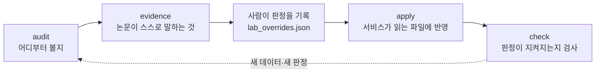

# 논문 귀속 검증: 이 논문이 정말 이 교수의 논문인가

- 기준일: 2026-11-25
- 도구: `tools/paper_attribution.py` (표준 라이브러리만 사용), 테스트: `tests/test_paper_attribution.py`
- 사례 번호(D-16~D-26, S-06)는 [정제 사례집](../../data/sunwoo/curation/CASES.md)을 가리킨다.

## 1. 무엇이 문제인가

논문은 OpenAlex의 **저자 프로필**을 따라 모은다. 그런데 프로필은 사람이 아니라 OpenAlex가 이름·소속·공저자로 자동으로 묶은 것이다. 흔한 이름이면 여러 사람의 논문이 한 프로필에 합쳐진다.

박성우 교수(컴퓨터공학과, 프로그래밍언어 연구실)의 프로필 `A5100324409`에는 최소 일곱 사람이 섞여 있었다: LANL의 물리학자, 순천향대 부천병원 의사, 서울대 정치외교학부 교수, 풍산 연구원, 동아대 연구교수, POSTECH·IBS 경력의 화학자, 그리고 본인. 2018년 이후 79편의 저자 소속이 36곳이다.

그래서 **프로필이 맞다는 것과 그 안의 논문이 본인 것이라는 것은 다른 문제**다. 논문은 한 편씩 근거가 있어야 한다.

## 2. 두 연구실은 어떻게 검증 대상이 됐고, 무엇을 했나

| | 최영준 (물리학과) | 박성우 (컴퓨터공학과) |
|---|---|---|
| 발견 | 2026-11-05 사용자가 화면에서 관광·교육 논문을 보고 제보 | 같은 날 최영준 건을 고치다 PL 연구실 논문이 이상해 별도 조사, 이어진 전체 감사에서 1순위로 외부 확인 |
| 왜 통과했었나 | 최근 부임이라 학교 논문 목록이 없었고, '반대 증거가 없는 프로필은 전부 본인 논문'(D-15)으로 들어옴 | 프로필이 학교 목록과 14편 겹쳐 '본인 확인'이 됐고(D-11), 그 프로필의 최근 논문을 그대로 씀(D-17) |
| 자동 신호 | 논문별 저자 검증에서 6편 모두 `held`(근거 없음) | 10편 모두 `held`, 프로필 소속 기관 62곳 |
| 확인한 것 | 연구실 공식 논문 목록 7편의 DOI·제목·저자, Caltech 학위논문, 본인 ORCID | 논문마다 출판사·학술지가 등록한 저자 소속, 교수의 공식 경력, 논문에 등록된 본인 ORCID |
| 판정 | 기존 6편 모두 제외, 공식 목록 7편만 허용 (D-16) | 11-05에 6편 제외(D-18), 11-24에 남은 4편 제외(D-19)하고 본인 논문 2편 허용(D-20) |
| 결과 | 6편 → 7편 | 10편 → 2편, 합쳐진 프로필은 새 논문 알림 출처에서도 뺌(D-21) |

배포본(`final`)에는 11-05의 판정이 11-24까지 반영되지 않았다. 그동안 운영 사이트의 박성우 연구실에는 격자 QCD 논문이, 최영준 연구실에는 관광학 논문이 보였다(D-22).

## 3. 일반화한 절차

### 1단계. 찾기: `python3 tools/paper_attribution.py audit`

서비스가 보여 주는 논문마다 **논문 단위 근거**가 있는지 센다. 네트워크를 쓰지 않는다.

| 분류 | 뜻 |
|---|---|
| 검토(`reviewed`) | 사람이 공식 출처와 대조해 허용 목록에 넣은 논문 (`ownership_verification`이 있음) |
| 확인(`confirmed`) | 2026-10-27 논문별 저자 검증(`curation/paper_identity.jsonl`, 규칙 `identity-v1`)에서 학교 논문 목록 또는 **논문 자체의** ORCID로 확인된 쌍 |
| 미확인(`unverified`) | 저자 프로필에 붙어 있다는 것, POSTECH 소속 표시, 연구소개에 제목이 나온다는 것 말고는 근거가 없는 논문 |

연구실은 네 단계로 나뉜다. 단계는 '어디부터 볼지'이지 판정이 아니다.

| 단계 | 조건 | 2026-11-25 현재 |
|---|---|---|
| 1 먼저 확인 | 근거 있는 논문이 한 편도 없고 미확인이 3편 이상 | 14곳 |
| 2 확인 필요 | 미확인이 3편 이상이면서 절반 이상 | 39곳 |
| 3 일부 미확인 | 미확인이 1편 이상 | 144곳 |
| 0 | 미확인 없음 | 110곳 |

전체 2,757편 중 검토 23편, 확인 2,116편, 미확인 618편이다. 1·2단계 목록은 `audit --write`로 `data/sunwoo/curation/paper_attribution_audit.json`에 저장한다.

함께 보여 주는 참고 신호: `profile_flagged`(소속 검사에서 합쳐진 프로필로 보임, D-10), `no_list_match`(학교 목록으로 프로필을 확인하지 못함), `suspect_papers`(`tools/build_suspect_papers.py`가 표시한 논문이 있음), `after_exclusions`(일부를 뺐고 나머지는 미확인), `feed_follows_profile`(미확인이 절반 이상인데 새 논문 알림이 이 프로필을 따라감).

### 2단계. 근거 모으기: `python3 tools/paper_attribution.py evidence <연구실 ID>`

OpenAlex와 Crossref를 키 없이 조회해 세 가지를 보여 준다. 응답은 `.local/paper_attribution/`에 캐시한다(커밋하지 않음).

1. **프로필 구성**: 프로필마다 2018년 이후 논문 수, 저자 소속 기관 수와 상위 기관, 분야. 한 사람의 경력이면 기관이 몇 곳이고 분야가 한두 개다.
2. **논문별 저자 소속**: 그 논문에 적힌 해당 저자의 소속(OpenAlex 원문 소속, Crossref에 출판사가 등록한 소속과 ORCID).
3. **빠진 본인 논문 후보**: 학교 목록에 있는데 선정에 없는 2018년 이후 제목을 OpenAlex에서 제목으로 찾은 결과. 본인 논문이 어떤 프로필에도 없을 수 있다(D-20).

### 3단계. 판정을 기록한다: `data/sunwoo/curation/lab_overrides.json`

도구는 판정하지 않는다. 사람(또는 출처를 남기는 AI 도구)이 근거를 보고 아래 기준으로 판정을 적는다.

**본인 논문으로 인정하는 근거** (하나 이상)
- 학교 논문 목록: 제목·연도·학술지·저자가 맞음
- 연구실 공식 논문 목록에 있음
- 출판사가 그 논문에 등록한 ORCID가 본인 ORCID와 같음. 본인 ORCID는 ORCID 기록의 소속이나 여러 확인 논문으로 따로 확인한다

**다른 사람 논문으로 제외하는 근거** (모두 필요)
- 출판사·학술지가 등록한 그 논문의 저자 소속이 교수의 공식 경력(전임 기간)과 양립할 수 없음
- 본인 ORCID, 학교 목록, 연구실 목록 어디에도 없음

**근거가 되지 못하는 것**
- 저자 프로필에 붙어 있음, 프로필에 붙은 ORCID (프로필 자체가 섞여 있을 수 있다)
- POSTECH 소속 표시만 있음 (같은 학교의 동명이인, D-19)
- 분야가 다름, 학교 목록에 없음 (이것만으로는 빼지 않는다. 최근 부임 교수의 이전 기관 논문은 정상이다)

**기록 형식**

| 필드 | 내용 |
|---|---|
| `paper_exclusions[]` | `openalex_id`, `doi`, `title`, `severity: "P0"`, `checked_at`, `reason`, `sources`(https 주소 1개 이상), 선택 `aliases`(같은 논문의 다른 판의 ID·DOI) |
| `paper_allowlist` | `orcid`(없으면 null), `checked_at`, `scope`, `works[]` = `openalex_id`, `doi`, `title`, `author_name`, `source`(https), 선택 `author_id`(프로필이 없으면 null), `observed_orcid`, `basis`, `versions` |
| `openalex_author_ids` | 계속 쓸 프로필만. 쓸 수 없는 프로필은 빼면 `raw_author_ids`에 기록으로 남는다 |
| `identity_verification` | 누가 언제 무엇을 확인했는지, 넣지 않은 논문과 이유(`considered_not_added`) |

허용 목록이 있는 연구실은 목록의 논문만 보여 준다. 편수를 채우려고 다른 논문을 넣지 않는다. 0편도 허용한다.

### 4단계. 반영: `python3 tools/paper_attribution.py apply <연구실 ID>`

한 연구실의 판정을 서비스가 읽는 파일에 차례로 옮긴다. 다른 연구실의 줄은 바이트 그대로 둔다.

| 파일 | 바뀌는 것 |
|---|---|
| `labs.jsonl` | 그 연구실 `openalex`의 판정 사본, `author_ids`, `raw_author_ids` |
| `papers.jsonl` | 그 연구실 논문 묶음. 허용 목록 논문은 OpenAlex 기록으로 새로 만들고 `ownership_verification`을 붙인다. 제외 논문은 ID·DOI·다른 판 ID로 뺀다. 남은 논문이 확인된 것이 아니면 `basis`가 `unverified_after_exclusions`다 |
| `app_profiles.jsonl` | 그 연구실 프로필 한 줄(`tools/build_curated_profiles.py`의 `profile()`) |
| `lab_course_bge_m3.json` | 그 연구실의 예전 과목 유사도를 빼고 `requires_recompute`에 적는다. 프로필 파일 해시를 갱신한다 |
| `IMPORT_MANIFEST.json` | 반입 뒤 고친 파일의 현재 해시(`corrected_files`)와 수정 이력(`corrections`) |

논문 기록이 검토 때와 다르면(DOI, 제목, 저자, ORCID) 아무것도 쓰지 않고 멈춘다. 여러 번 실행해도 결과가 같다. `--offline`은 캐시만 쓴다.

**저장소 밖 자료는 따로 다시 만들어야 한다.** 워커의 문서 임베딩과 검색 조각, 서버 DB의 `phrase_sims`·AI 가이드 캐시는 예전 논문으로 만들어졌다. 순서는 [반입 기록](../../data/sunwoo/IMPORT.md)의 '외부 워커를 다시 연결하기 전'을 따른다. 두 가지는 코드가 막는다: 연구실 요약은 검토된 연구실의 캐시 키에 논문 ID가 들어가 그 연구실만 새로 만들어지고(`ResearchGuide.summary_key`), 검색 조각은 `tools/embed_worker/build_search_assets.py`가 연구실 묶음에 없는 논문을 뺀다.

### 5단계. 지키기: `python3 tools/paper_attribution.py check`

네트워크 없이 사슬 전체를 검사하고, 문제가 있으면 종료 코드 1을 낸다. `tests/test_paper_attribution.py`가 저장소 데이터로 이 검사를 실행하므로 단위 테스트에서 걸린다.

- 판정 기록에 이유·출처가 빠지지 않았는가
- `labs.jsonl`의 판정 사본과 `author_ids`가 판정과 같은가
- 제외한 논문이 `papers.jsonl`·`app_profiles.jsonl`에 남아 있지 않은가 (ID가 바뀌어도 DOI로 잡는다)
- 허용 목록 연구실에 목록 밖 논문이나 검토 기록 없는 논문이 없는가
- **모든 연구실**의 프로필 대표 논문이 현재 `papers.jsonl`과 같은가
- `lab_course_bge_m3.json`의 입력 해시가 현재 파일과 같은가 (다르면 서버가 과목 유사도 전체를 읽지 않는다)
- 프로필이 바뀐 연구실이 예전 과목 유사도를 그대로 쓰고 있지 않은가
- `IMPORT_MANIFEST.json`의 해시, 대기열 파일이 현재 데이터와 같은가

## 4. 이 방법이 유효한지 확인한 것 (2026-11-24)

1. **고치기 전 배포본 데이터에서 두 연구실을 찾아내는가.** `final`의 데이터로 `audit`를 돌리면 1단계가 18곳이고, 대기열의 첫 두 줄이 최영준·박성우다. 반대로 분야가 먼 논문 수, 주제 어휘 겹침은 박성우를 다른 연구실과 구분하지 못했다(10편 중 3편만 걸림). 그래서 신호로 채택하지 않았다.
2. **기록만 하고 반영하지 않은 상태를 잡는가.** 판정만 적고 `check`를 돌리면 박성우 한 곳에서 17건, 배포본 데이터에 두 판정을 얹으면 60건이 나온다.
3. **새 사례를 찾는가.** 나머지 1단계 16곳에 `evidence`를 돌렸다. 13곳은 프로필의 기관이 2~7곳이고 분야가 일관돼 한 사람의 경력(이전 기관 → POSTECH)으로 보인다. 3곳에서 다른 사람 논문으로 보이는 것이 나와 2026-11-25에 논문별로 확인했다. 두 곳은 실제로 다른 사람 논문이 있었고, 한 곳은 본인 논문이었다.

| 연구실 | 관찰 | 확인한 것 | 판정 |
|---|---|---|---|
| 박상돈 (인공지능대학원) | 10편 중 6편: KAIST 소속 네트워크 요금 논문 3편, 국가보안기술연구소 소속 법·정책 논문 3편 | KAIST 3편은 출판사가 등록한 ORCID가 KAIST 박사·박사후연구원 경력의 다른 박상돈 것(D-24). 국가보안기술연구소 2편은 학술지·DBpia의 저자 소속. 남은 1편(2018)은 소속 기록을 찾지 못함 | 5편 제외. 홈페이지 목록·학교 목록으로 확인한 7편을 허용 목록으로(10편 → 7편). 합쳐진 프로필을 알림 출처에서 뺌 |
| 이승우 (물리학과) | 8편 중 1편: 층간소음 사법 구제 논문 | 법학 논문은 ORCID도 소속 기록도 없음. 나머지 7편은 본인 ORCID(5편) 또는 POSTECH 물리학과 소속(2편) | 확인된 7편만 허용 목록으로(8편 → 7편, D-25) |
| 김형훈 (인공지능대학원) | 7편 중 1편: UNIST 소속 인문학 발표 초록 | Zenodo 기록의 소속이 UNIST이고 본인의 2023~2024년 논문도 UNIST 소속 | 본인으로 보고 유지(D-26) |

4. **테스트.** 합성 데이터 20건(대기열 단계, 판정 형식, 제외·허용 반영, 다른 줄 불변, 반복 실행, 기록이 바뀌면 중단, 검사가 잡는 다섯 가지, 근거 수집)과 저장소 데이터 2건.

## 5. 한계와 다음 일

- 미확인 618편이 모두 틀린 것은 아니다. 대부분은 학교 목록이 없는 최근 부임 교수의 논문이나, 학회판·학술지판 차이로 보류된 본인 논문이다. 1·2단계 53곳을 사람이 봐야 줄어든다.
- `paper_identity.jsonl`은 2026-10-27 시점의 판정이다. 그 뒤 들어온 논문에는 판정이 없어 미확인으로 센다. 판정 도구(`tools/paper_identity.py`)는 이전 `sunwoo` 브랜치(`backup/sunwoo-before-final-20261113`)에만 있고 현재 저장소로 옮기지 않았다.
- `evidence`의 저자 찾기는 프로필 ID와 영문 이름에 기대므로, 영문 이름이 없는 교수는 저자를 못 찾을 수 있다.
- 박성우 교수의 `core_topics`는 비웠다. 확인된 논문이 2편이라 핵심 분야를 계산할 수 없다. 연구실의 연구 분야(사람이 적은 8개)는 그대로다.
- 운영 반영(워커 자료 재생성, 서버 캐시 정리, 배포)은 이 문서의 범위 밖이며 하지 않았다.
