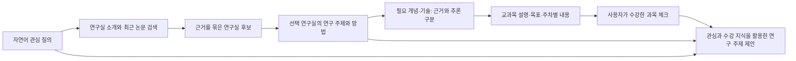

# 연구실·학부 교과목 데이터 분석과 최근 논문 활용 설계

> 2026-10-31: 이 문서 초반의 `data/raw/`·루트 `final_*.jsonl` 경로는 당시 분석 대상이다. 중복 제거 후 현재 파일은 `data/sunwoo/` 스냅샷에 있으며, 옛 입력은 작업 폴더 밖 백업에 보관했다. 이전 실험 수치는 옛 스냅샷 기준으로 유지한다.

> 2026-11-24: 논문과 교수의 연결을 논문 단위로 검토하는 절차와 도구를 두었다([논문 귀속 검증](PAPER_ATTRIBUTION_REVIEW.md), `tools/paper_attribution.py`). 저자 프로필은 여러 동명이인이 합쳐질 수 있어 프로필에 붙어 있다는 것만으로 본인 논문으로 보지 않는다. 박성우 연구실은 남은 4편을 제외하고 본인 논문 2편으로 바꿨다. 2026-11-25에는 박상돈(동명이인 논문 5편 제외, 확인된 7편)과 이승우(확인된 7편) 연구실을 같은 절차로 고쳤다. 서비스가 보여 주는 2,757편 중 논문 단위 근거가 있는 것은 2,139편이고 618편은 미확인이다. 아래 10절.

> 2026-11-04: 서비스는 `data/sunwoo/` 정제본의 추천 가능 연구실 307곳·과목 1,151개와 대표 논문을 사용한다. BGE-M3로 연구실·과목 문서를 사전 임베딩했으며 유사도 연결은 검증된 선수과목 주장으로 취급하지 않는다. 아래 예전 앱 데이터 비교와 실험 수치는 당시 스냅샷의 기록이다.

- 작성일: 2026-10-08
- 대상: `data/raw/lab_processed.jsonl`, `data/raw/UG_2026_curriculum_courses.jsonl`
- 비교 대상: `data/labs.jsonl`, `courses.jsonl`과 기본 추천 코드
- 사용자 제공 정보: 연구실별 최근 논문 제목·초록도 수집 중이다. 이번 두 파일에는 논문별 제목·초록 구조가 없으며, 별도 논문 수집 결과는 이번 분석 대상에 포함되지 않았다.
- 방식: 전체 JSONL 파싱·필드 집계·본문 사례 확인·현재 앱 데이터와 비교. 외부 출처 사실 확인이나 추천 품질 평가를 수행한 결과는 아니다.
- 재확인 자료: [필드별 통계 및 파일 SHA-256](RECOMMENDATION_DATASET_STATS.json), [서비스 코드 분석](SERVICE_CODEBASE_ANALYSIS.md)

## 1. 분석 결론

두 데이터셋은 연구실 추천과 과목 연결의 원자료로 활용할 수 있다. 과목 데이터는 설명·학습목표·주차별 계획을 포함해 학습 지식을 추출할 기반이 있다. 연구실 데이터에는 연구 소개와 논문 목록이 있으나 구성원·뉴스·메뉴가 섞이고, 논문 목록의 상당 부분이 축약되어 있다. 바로 전체 행을 하나의 벡터로 만드는 방식보다는 연구 내용과 출처를 분리해 쓰는 편이 적합하다.

최근 논문 제목·초록은 관심 검색뿐 아니라 연구 주제 제안의 근거를 보강한다. 다만 초록은 학부생에게 필요한 사전 지식·실습 환경·장비 접근·수행 난이도를 모두 설명하지 않는다. 논문에서 확인한 사실과 서비스가 추론한 준비 사항을 구분해야 한다.

권장 연결은 다음과 같다.



원래 관심 질의는 마지막 단계까지 유지한다. 같은 연구실과 같은 과목을 선택했어도 관심이 다르면 제안할 주제와 시작 방법이 달라질 수 있다.

## 2. 연구실 데이터 구조와 수록 범위

60행 모두 JSON 객체로 정상 파싱된다. 교수 이름 중복은 없다. 각 행의 필드는 `name`, `department`, `lab_url`, `research_intro`, `admission`, `publications`, `source`다. 정규 연구실 ID·교수 ID·수집 시점·문단별 출처 URL은 없다.

| 항목 | 건수 | 의미 |
|---|---:|---|
| 교수 기준 기록 | 60 | 정규화된 독립 연구실 수가 아님 |
| Computer Science | 26 | 수록 레코드의 학과 필드 |
| Electrical Engineering | 27 | 동일 |
| IT Convergence | 6 | 동일 |
| Semiconductor Engineering | 1 | 동일 |
| 연구소개 값 있음 | 57 | 값이 있다는 사실이며 충분한 연구 근거 여부와 다름 |
| 모집 안내 값 있음 | 10 | 현재 모집 중임을 뜻하지 않음 |
| 논문 목록 값 있음 | 40 | 구조화된 개별 논문·초록 목록이 아님 |
| `source == categorized` | 46 | 수집 본문 분류 방식 |
| `source == unclassified_fallback` | 14 | 연구소개 칸의 본문 성격을 추가 확인할 필요 |

`source`는 출처 URL이 아니라 처리 방식의 범주다. 홈페이지가 있다는 사실만으로 특정 문장·논문의 출처를 정확히 추적할 수 있는 것은 아니다.

### 실제 내용에서 관찰한 품질 문제

- **본문 혼입:** 서영주 연구소개에는 AIoT·음성 연구 내용과 Lab News 기사·반복 뉴스가 섞여 있다. 공병돈 연구소개에는 연구 주제와 구성원 학력·관심·연락처가 함께 들어 있다. 연구 관심 검색에 뉴스·학력·연락처를 동일한 근거로 쓰지 않는다.
- **길이 편차:** 비어 있지 않은 연구소개 길이는 최소 66자, 중앙값 1,725자, 최대 66,798자다. 긴 행에는 서로 다른 페이지·뉴스가 포함될 수 있어 길이가 곧 연구 정보량은 아니다.
- **소개 부족:** 이승용·조민수·안성수의 `research_intro`는 null이다. 다른 논문 필드가 있으므로 전체 행을 바로 제외할 필요는 없다.
- **제목 수준 정보:** 김경태 연구소개는 194자이고 메뉴·주소가 포함된다. 심재윤은 177자로 ‘Under construction’과 주제 이름들이 있다. 이근배는 66자로 Question Answering·Dialogue System·Speech 등의 이름만 있다.
- **빈 실질 내용:** 백승환의 `admission`은 ‘Join Us’ 7자다. 김정훈·심재윤·송재용의 `publications`는 각각 60·140·59자로 목록 제목이나 메뉴에 가깝다. 단순 nonempty 집계만으로 논문 확보율을 판단하지 않는다.
- **중복 단위:** `http://mad.postech.ac.kr/`가 두 교수 기록에 있고, 송호진·홍원빈의 연구소개는 동일하다. 별칭·공동 홈페이지 묶기가 필요하다. 같은 본문이 있다고 동일 교수로 합치지는 않는다.
- **논문 목록 절단:** 값이 있는 논문 목록은 모두 2,999자 이하이며, 현재 앱 원본과 비교하면 31건이 더 긴 원문의 앞부분이다. 공백 정규화 후 모두 접두부 일치다. 예: 공병돈 2,996자 대 앱 20,874자, 이근배 2,936자 대 앱 121,842자. 해당 31건은 이 파일만으로 전체 논문 이력을 복원할 수 없다.

최근 논문이 앞에 있을 것이라고 가정해서 앞부분만 쓰지 않는다. 목록 정렬·연도·논문별 연결을 확인해야 한다. 이번 비교는 절단 형태를 확인한 것이며, 어느 수집 코드가 왜 절단했는지는 확인하지 않았다.

## 3. 과목 데이터 구조와 활용도

419행 모두 JSON 객체로 정상 파싱되고, 원문 `course_code` 문자열 중복은 없다. 필드는 과목 코드·국문/영문 이름·학점 원문·설명·강의목표·선수사항·참고자료·주차별 계획·강의계획 식별자다.

| 필드 | 비어 있지 않은 값 | 추천에서 활용할 정보 |
|---|---:|---|
| `course_name_kr`, `course_name_en` | 각 419 | 관심 표현·과목명 검색·화면 표시 |
| `content` | 418 | 과목의 범위와 설명 |
| `course_objectives` | 408 | 어떤 내용을 배우는지 |
| `course_plan` | 397 | 주차·세부 개념·방법·도구 |
| `prerequisites` | 336 | 수강 전 권장·필수 지식 원문 |
| `course_references` | 324 | 교재·학습 자료 |
| `syllabus_source_id` | 419 | 강의계획 식별값; 실제 출처 URL·학기와 다름 |
| `syllabus_matched_code` | 24행에 필드 있음 | 합쳐진 코드 등에서 어떤 코드의 계획을 연결했는지 |

이 표는 null·빈 문자열 기준이다. 강의목표에는 ‘-’, 주차별 계획에는 ‘.’·‘TBA’가 있어 실제 학습 내용 확보율은 표보다 낮다. 빈 선수사항과 ‘없음’은 다르게 해석한다. 앞의 경우 미확보일 수 있고 뒤의 경우 명시적 선수조건 없음이다.

첫 과목 코드의 접두부는 15종이다.

| 접두부 | 행 수 | 접두부 | 행 수 | 접두부 | 행 수 |
|---|---:|---|---:|---|---:|
| AMSE | 30 | CHEB | 38 | CHEM | 23 |
| CITE | 22 | CMEF | 16 | CSED | 37 |
| DISU | 14 | EECE | 48 | ENTP | 6 |
| IMEN | 33 | LIFE | 26 | MATH | 36 |
| MECH | 32 | PHYS | 29 | SEMI | 29 |

접두부별 집계는 첫 코드 기준이며 실제 학과별 독립 과목 수가 아니다. 파일 이름의 ‘2026’만으로 모든 연결 강의계획의 적용 학기와 최신성을 확정할 수 없다. 예를 들어 AMSE100의 주차 계획에는 9/7 등 일정과 초청 강연이 있으나 별도 연도 필드가 없다.

### 과목 연결에서 주의할 사례

- **복합 코드 20행:** `CITE241/MECH361` 같은 공동 표기와 `MATH301, 302`, `PHYS101, 102` 같은 묶음이 함께 있다. 슬래시와 쉼표를 모두 동등 과목이라고 처리하지 않는다. 확인된 별칭과 여러 과목 묶음을 구분한다.
- **부분 강의계획:** `PHYS101, 102`는 `syllabus_matched_code == PHYS101`, `MATH301, 302`는 MATH302다. 두 코드 전체가 같은 학습 내용이라고 단정하면 수강 체크가 과대 해석될 수 있다.
- **식별자 형식 혼합:** 418개 `syllabus_source_id`는 정수이고 `EECE419/DISU404` 한 행은 `raw:EECE419` 문자열이다. DB·직렬화에서 숫자로만 선언하지 않는다.
- **이름·코드 확인 필요:** MATH409의 국문 이름은 ‘489 특강Ⅰ, Ⅱ, Ⅲ’, 설명은 비었으나 목표·계획은 계산 선형대수와 QR/SVD/PCA·과학 계산을 설명한다. 코드·이름·계획 대응을 확인할 대상으로 삼는다. 이번 읽기만으로 잘못 매칭됐다고 확정하지 않는다.
- **개론과 실습의 차이:** AMSE100은 여러 연구 분야 소개·강연이고 AMSE201은 결합·구조·결함·확산·물성의 기초를 다룬다. 같은 반도체 단어가 있어도 준비 지식의 깊이가 다르다.

과목은 ‘학습하는 개념·방법·도구’와 근거 문장을 추출하고, 연구 주제에 필요한 지식과 연결해야 한다. 과목명만으로 연구 수행 능력을 판정하지 않는다. 선수사항 역시 교과목 수강의 조건이며 연구실 지원의 공식 조건이 아니다.

## 4. 현재 앱 데이터와의 관계

### 과목

419개 모두 현재 앱의 `data/courses.jsonl`과 코드 기준으로 연결된다. 국문·영문 이름, 학점, 설명, 목표, 선수사항, 주차별 계획은 각각 전 행에서 값이 일치한다.

| 이번 원본 필드 | 앱 필드 |
|---|---|
| `content` | `description` |
| `course_objectives` | `objectives` |
| `prerequisites` | `prerequisites_text` |
| `credit` | `credit_original` |
| 코드·이름·주차 계획 | 동일 이름의 대응 필드 |

현재 앱에는 `record_id`, `source`, `quality_flags`가 추가되어 있다. 반대로 이번 파일의 `course_references`는 앱 과목 스키마에 없다. 324개 비어 있지 않은 참고자료를 학습 가이드에 활용할 여지가 있다. 교재명이나 URL이 실제 접근 가능한 학습 자료인지 별도 확인해야 한다.

### 연구실

60명 모두 앱의 65개 교수 기준 기록과 이름으로 연결되고 앱에는 5개의 excluded 기록이 추가로 있다. categorized의 연구소개 46건은 앱 `sections.research_intro.text`와 일치하며, fallback의 14건은 앱에서 `sections.unclassified.text`로 저장되어 있다.

따라서 두 파일을 신규 연구실 60곳·신규 과목 419개로 추가하면 중복된다. 원자료/변환자료 관계를 관리해야 한다. 앱 연구실 자료에는 정규 ID·품질 표시·섹션별 출처 등이 있고 31건에서 더 긴 논문 본문이 있어, 새 짧은 파일로 일괄 덮어쓰면 근거가 줄어든다.

이번 분석은 파일을 비교한 것이며, 현재 앱 데이터가 언제 어떤 코드로 변환되었는지 전체 생성 이력을 검증한 것은 아니다.

## 5. 최근 논문 제목·초록을 모을 때 권장하는 저장 구조

현재의 자유 텍스트 `publications`와 별도로 논문마다 한 레코드를 두고, 논문과 연구실의 연결은 다대다로 관리하는 방식을 제안한다. 공동 논문은 여러 연구실의 근거가 될 수 있기 때문이다.

```json
{
  "paper_id": "stable-internal-id",
  "title": "원문 제목",
  "abstract": "원문 초록 또는 null",
  "publication_date": null,
  "date_precision": "unknown",
  "doi": null,
  "venue": null,
  "authors": [],
  "source_url": "논문 상세 또는 출판사 페이지",
  "collected_at": "실제 수집 시각",
  "abstract_source_url": null
}
```

```json
{
  "paper_id": "stable-internal-id",
  "lab_id": "앱 정규 연구실 ID",
  "professor_id": "교수 식별자",
  "match_basis": "연구실 논문 목록 등 연결 근거",
  "match_source_url": "연결을 확인한 출처",
  "verification_status": "unreviewed"
}
```

이는 제안 스키마이며 현재 파일 필드가 아니다. publication_date가 null이라고 현재 논문으로 간주하지 않는다. 연도만 있으면 날짜 정밀도를 year로 기록하고 임의의 월·일을 채우지 않는다. 교수 이름 문자열 하나에만 의존하면 동명이인·과거 소속·공동연구가 섞일 수 있다.

관리할 기준은 다음과 같다.

1. DOI 등 외부 식별자를 우선하고 없으면 정규화한 제목·저자·연도 등으로 중복 후보를 찾는다. preprint와 출판본은 관계를 남긴다.
2. ‘최근’의 기간을 명시한다. 예를 들어 최근 3년을 시작 기준으로 둘 수 있으나 분야별 연구 주기와 확보 자료에 따라 조정하며 고정된 정답은 아니다.
3. 논문 제목만 확보, 초록 확보, 연구실 연결 확인 상태를 각각 기록한다. 없는 초록을 LLM으로 만들어 원문 초록 필드에 저장하지 않는다.
4. 논문·초록 출처 URL과 수집 시점을 남긴다. 수집량이 많다는 이유만으로 연구실 추천이 유리해지지 않게 한다.
5. 사용자가 확인할 수 있는 추천 근거는 논문 제목·초록 원문 구절과 출처를 함께 보존한다.

## 6. 추천 흐름에서 논문을 활용하는 방법

### 자연어 → 연구실

연구실의 안정적인 소개와 최근 논문의 구체적인 주제를 함께 검색한다. 두 종류의 근거를 별도로 보존해 ‘홈페이지 소개와 연결됨’, ‘최근 논문과 연결됨’을 구분할 수 있게 한다.

임베딩 입력은 정제된 소개의 주제별 문단과 논문별 제목+초록으로 만든다. 홈페이지 메뉴·뉴스·연락처·수강 조건을 연구 주제와 동일하게 넣지 않는다. 검색 결과는 논문별 점수에서 연구실별 후보로 모으되, 관련 논문 상위 몇 건을 중심으로 집계하고 반복 내용은 제거한다. 논문 수 합계나 특정 분야의 방대한 출판량 자체가 추천 점수가 되지 않게 설계한다.

초록이 없는 논문은 제목 근거로 검색할 수 있지만 이를 초록 기반 확인과 동일한 신뢰로 표시하지 않는다. 최근 논문 하나가 연구실 전체의 현재 방향을 대표한다고 단정하지 않는다.

### 연구실 → 관련 교과목

연구실 전체와 과목 전체의 유사도 하나만 비교하기보다, 선택 연구실의 관련 논문 또는 연구 주제별로 다음을 연결한다.

- 연구 문제·대상: 무엇을 다루는가.
- 방법·도구: 어떤 접근법을 쓰는가.
- 필요한 개념·기술: 이해·탐색·재현에 도움이 될 지식은 무엇인가.
- 과목 근거: 설명·목표·주차 계획에서 이 지식을 어디서 배우는가.

첫 두 항목은 논문에서 직접 확인할 수 있고, 세 번째 항목은 초록에 명시되지 않으면 서비스의 추론이다. 각 연결에 `relation_type`, `evidence`, `source_ref`, `review_status` 같은 정보를 남긴다. 실제 실습 환경·장비 사용은 별도 확인이 필요하다.

현재 `core/application`과 도메인/방법 구분을 유지하면서, 논문 주제별 과목 관계를 추가할 수 있다. 논문 속 응용 분야가 등장했다는 이유만으로 그 분야의 모든 과목을 요구하지 않는다.

### 체크한 과목 → 연구 주제

입력은 원래 관심 질의 + 선택 연구실 + 관련 논문/소개 + 체크한 과목의 학습 내용으로 구성한다. 체크한 과목 개수나 벡터 평균 하나로 준비도를 결정하지 않는다.

출력 항목은 주제, 연구실/논문과의 연결, 활용할 수강 지식, 시작할 활동, 추가 준비, 확인할 제약, 근거다. ‘이미 연구실에서 진행 중인 프로젝트’와 ‘논문에서 영감을 받은 서비스 제안’을 구분한다.

예를 들어 관련 논문이 실제로 영상 분류를 다루고 과목 계획에 선형대수·확률이 있다면, 공개 데이터·코드가 확인되는 범위에서 분류 방법 비교를 제안할 수 있다. 이 예시는 연결 방법의 설명이며 특정 연구실이나 논문의 검증된 추천 결과가 아니다. 논문과 연결되는 과목을 모두 수강했다고 논문의 실험 전체를 수행할 수 있다고 판정하지 않는다.

## 7. 우선 작업과 판단 기준

| 우선 작업 | 이유 | 확인할 결과 |
|---|---|---|
| 원자료/앱 데이터 대응표·정규 ID 유지 | 동일 419과목·60교수 중복 입력 방지 | 변환 이력과 ID 대응이 설명 가능 |
| 연구 본문에서 뉴스·메뉴·구성원 정보를 분리 | 관심 검색의 노이즈 감소 | 추천 근거가 실제 연구 문장인지 |
| 절단되지 않은 논문 원문·최근 논문별 레코드 확보 | 앞부분 목록만으로 최신 주제 판단 방지 | 논문별 날짜·출처·초록·연구실 연결 상태 |
| 복합 과목 코드와 부분 계획 검토 | 잘못된 수강 지식 합산 방지 | 공동 코드/복수 과목 구분과 선택 단위 |
| 목표·주차별 계획에서 학습 개념 추출 | 과목명을 넘는 설명 가능한 연결 | 연결마다 과목 근거가 존재 |
| 연구 주제별 필요한 지식 연결 검토 | 의미 유사도와 준비 조건 구분 | 직접 근거·서비스 추론·미확인 사항 구별 |
| 학생 표현으로 단계별 평가 | 검색만 좋아져도 최종 추천은 틀릴 수 있음 | 연구실 관련성, 과목 도움, 주제 근거·시작 가능성 |

현재 JSONL은 데이터 규모보다 정보 정제·정규화·출처 추적이 먼저 중요한 상태다. 최근 논문 초록이 들어오면 단어 밖 표현을 찾는 검색과 연구 주제 설명을 개선할 기반이 생기지만, 실제 개선 폭은 평가해야 한다. 이번 작업에서는 추천 코드나 데이터 원본을 변경하지 않았다.

## 8. 2026-10-16 최종 JSONL과 목적별 임베딩 입력 실험 보충

위 419과목·60교수 등 앱 변환 자료의 현황과, 이후 공급된 루트 `final_courses.jsonl` 1,316행·`final_labs.jsonl` 365행은 서로 다른 스냅샷이다. 최종 JSONL에서 정보량 프록시로 선별한 941과목·203교수 행, 공유근거 156구성요소를 대상으로 별도 재평가했다. 목표 근거·관계 스키마는 [`FINAL_DATASET_SCHEMA_V2_DECISION.md`](FINAL_DATASET_SCHEMA_V2_DECISION.md), 목적별 파생 입력 계약은 [`EMBEDDING_INPUT_SCHEMA_V1.md`](EMBEDDING_INPUT_SCHEMA_V1.md)에 둔다. 둘 다 현재 앱 구현 상태를 뜻하지 않는다.

새 필드 ablation은 이전 결과를 사용하지 않은 18공유근거 구성요소·28교수 행에서 두 Luna가 327쌍을 새로 판정했다. 동일한 BGE-M3 dense 256토큰·Kaggle T4 조건에서 `core`(연구 키워드·대표 논문 5개, 과목 설명·진도)와 양쪽 운영 메타데이터를 더한 입력을 비교했다. `core−both_admin`의 구성요소 가중 고정 5칸 효용 차이는 A +0.212(95% 구간 +0.117~+0.308), B +0.222(+0.113~+0.333)으로 사전 결정 문턱을 넘었다. 이에 따라 **준비 과목 후보 검색**의 기본 dense 임베딩 뷰에는 `core`를 사용하고 운영 필드는 별도 보존한다. 이는 공통 `core` 근거 창에서 판단 가능한 상위 노출 품질의 제한적 결과다. 연구실 발견, 실제 학생 효용, 운영 필드의 모든 개별 효과, 오피스·학생 수의 직접 효과는 검증되지 않았다. 상세 설계·분석·제한은 `reports/embedding_rule_schema_lecture_2026-10-16.pdf`에 기록했다.

## 9. 2026-10-31 `sunwoo` 브랜치 데이터 반입

`https://github.com/sunwoochoi2002/2026-UGRP.git`의 `sunwoo` 커밋 `0fa6c47aa4511b5a6db5edc424064109e9e957f9`에서 `data/` 전체 26파일을 [`data/sunwoo/`](../../data/sunwoo/IMPORT.md)에 별도 스냅샷으로 가져왔다. `final_courses.jsonl` 1,316행, `final_labs.jsonl` 365행, 정제본 `courses.jsonl` 1,316행·`labs.jsonl` 365행, 대표 논문 `papers.jsonl` 307행, 연구센터 `research_centers.jsonl` 29행과 정제·검증 기록을 포함한다. 이름이 같은 루트 최종 JSONL 및 현재 앱의 `data/courses.jsonl`·`data/labs.jsonl`은 새 파일과 해시가 다르다. 따라서 이 반입은 앱 데이터나 2026-10-16 실험 입력의 갱신이 아니다. 파일별 출처 해시와 크기는 `data/sunwoo/IMPORT_MANIFEST.json`에 기록했고 전 파일 파싱·해시 검사를 통과했다.

## 10. 2026-11-24 논문 귀속 검증

대표 논문은 OpenAlex 저자 프로필을 따라 모았다. 프로필은 이름으로 자동으로 묶인 것이어서, 박성우 교수의 프로필에는 최소 일곱 사람의 논문이 섞여 있었다. 그래서 5절의 '교수–논문 연결 근거(`match_basis`)'를 실제 데이터에서는 다음 세 가지로만 인정한다: 학교 논문 목록(제목·연도·학술지·저자), 연구실 공식 논문 목록, 논문 자체에 등록된 본인 ORCID. 저자 프로필, 프로필에 붙은 ORCID, POSTECH 소속 표시는 근거가 아니다.

| 구분 | 논문 수 | 출처 |
|---|---:|---|
| 사람이 공식 출처와 대조 (`ownership_verification`) | 23 | 최영준 7, 박성우 2, 박상돈 7, 이승우 7 |
| 논문별 저자 검증에서 확인 (`paper_identity.jsonl`의 `confirmed`) | 2,116 | 2026-10-27 규칙 `identity-v1` |
| 미확인 | 618 | 프로필·소속 표시만 있음 |

미확인이 곧 오류는 아니다. 최근 부임해 학교 목록이 없는 교수의 이전 기관 논문이 많다. 다만 추천 근거나 AI 요약의 입력으로 쓸 때는 이 구분을 알고 써야 한다. 연구실별 검토 대기열은 `data/sunwoo/curation/paper_attribution_audit.json`(1단계 14곳, 2단계 39곳)이고, 절차·판정 기준·기록 형식·검사 항목은 [논문 귀속 검증](PAPER_ATTRIBUTION_REVIEW.md)에 있다.

새 논문 알림(`curri/watch.py`)은 `papers.jsonl`의 `author_ids`로 OpenAlex를 조회한다. 합쳐진 프로필을 남겨 두면 다른 사람의 새 논문이 그 연구실 소식으로 나가므로, 쓸 수 없는 프로필은 `author_ids`에서 뺀다(사례 D-21).
