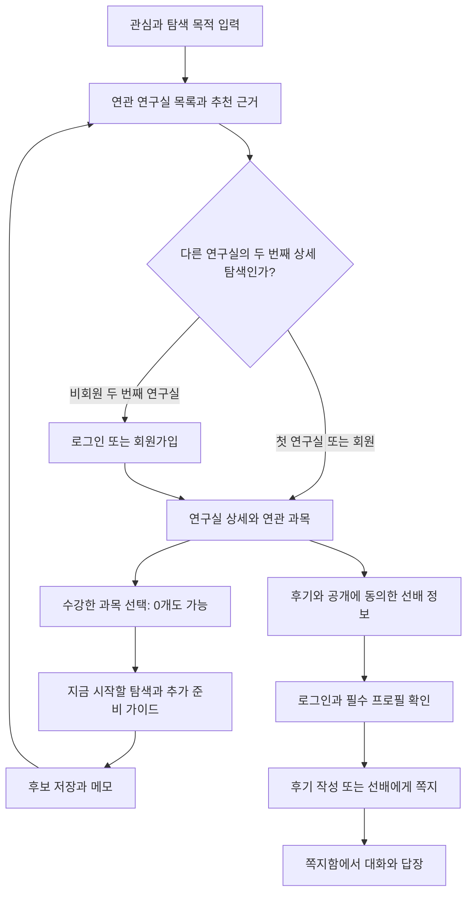
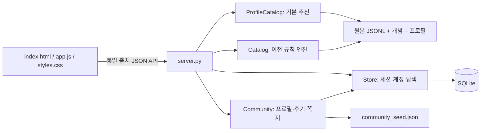

# 3분커리 서비스 골격 및 코드 분석

> 2026-11-05 가이드 전환: 기본 A는 기존 가이드다. B는 연구실 최근 논문을 최대 3편 선택하고 선택 논문의 직접 참고문헌(OpenAlex에서 최대 50건 조회 후 인용 수 순)과 제목 단어가 겹치는 동일 교수 논문을 보여 준다. 조회 실패와 근거 부족은 안내하며 기초 논문이나 실제 프로젝트라고 단정하지 않는다. 선택 논문은 가이드에 저장하고 과목 선택은 기존대로 유지한다. 서버 `.local/guide_variant` 파일의 A/B로 다음 탐색부터 전역 전환한다. 다른 버전의 이전 가이드는 삭제하지 않고 탐색 화면에서 숨긴다. 날짜·버전별 탐색과 가이드 생성 요청 수를 익명 집계한다. 요청 중복을 포함하며 이는 기간별 전환이므로 무작위 배정이나 인과 효과 측정은 아니다.

> 2026-11-05 검색·워커 보완: 과목 역방향 연결은 과목별 저장된 최고 유사도의 95% 이상만 유사 후보로 삼고 개설 학과 일치에 0.08을 더한다. 담당 교수 연결은 유사 후보보다 먼저 정렬한다. 이는 경험적 필터이며 관련성 검증을 대신하지 않는다. `선대·일물·컴구·운체·자료구조`는 실제 과목명 별칭으로 처리한다. 운영 전용 해석기는 수업을 듣고 빠진 대상과 목적어·수단을 쓰는 제어 문장을 분리한다. 의미 검색 점수가 없는 과목 후보도 오류 없이 카드로 표시한다. Kaggle 실행 전 status로 OAuth 갱신을 시도하며 실패 시 기존 10분 대기 정책은 유지한다. 앱 프로필은 재생성하지 않았다.

> 2026-11-04 데이터 전환: 현재 앱 기본 입력은 `data/sunwoo/` 정제 `labs.jsonl`·`courses.jsonl`·`papers.jsonl`에서 만든 `app_profiles.jsonl`이다. 이전 4개 학과 자료와 벡터는 서비스 추천에서 제외했다. 아래 과거 경로·행 수 설명은 해당 시점의 분석 기록이다.

> 2026-11-04 운영 갱신: 새 정제본으로 전환했다. 추천 가능 연구실 307곳의 근거 문장 3,979개와 추천 가능 과목 1,151개를 BGE-M3로 사전 임베딩했다. 긍정/부정 구절 해석과 연구실 임베딩 검색을 서비스에서 사용한다. Kaggle 워커가 꺼져 있으면 첫 검색이 자동 시작을 요청하고 브라우저가 최대 3분 대기한다. 과목 유사도는 학습 탐색 후보이며 공식 선수과목 관계가 아니다. 기존 4개 학과 벡터·연결표와 Kaggle 입력 묶음은 삭제했다.

> 2026-11-05 실사용 점검 갱신: (1) 2026-11-04 데이터 전환 뒤 운영 DB의 선배 30명·후기·대화가 이전 4개 학과 연구실 ID(`lab_…`)를 가리켜 어느 연구실 상세에도 선배가 보이지 않았다. `tools/build_legacy_lab_aliases.py`가 교수 이름이 한 곳과만 일치하는 이전 연구실 58곳을 `data/sunwoo/legacy_lab_aliases.json`으로 연결하고, `CuratedCatalog`가 이를 별칭으로 읽으며, `Community.migrate_lab_ids()`가 시작할 때 `users`·`reviews`·`threads`의 이전 ID를 현재 ID로 바꾼다(운영 선배 28/30). (2) 가입 관심 태그와 시드 선배의 태그 이름을 위해 이전 `concepts.json`(70개)을 `data/sunwoo/`에 두고 배포한다. (3) 사전 검색은 조사 제거·띄어쓰기 무시·한국어 연구 용어의 영어 표현 확장·IDF 가중(등록된 연구 용어 2배)·흔한 단어(연구실 25% 초과)만 일치한 결과 제외로 바꿨다. 질의 해석은 `궁금한데/지만` 같은 절 경계를 넘어 부정 구절을 잡지 않고, `ㅋㅋ` 같은 잡음과 중복 단어를 지운다. 임베딩 순위 계산은 바꾸지 않았다. (4) 화면 전환마다 브라우저 기록을 남겨 뒤로 가기가 사이트를 떠나지 않는다.

> 2026-11-05 수업 질의 갱신: 해석기가 `재밌었어요`·`좋았어요`·`흥미로웠어요`·`재미있어 보여요` 어미와 `별로예요`를 정리한다. `CuratedQueryEngine`은 좋아함 구절이 과목명과 같거나(`선형대수` → 선형대수학) 질의에 `수업·과목·강의`가 있으면 `CuratedCatalog.courses_named`로 과목을 찾고, `course_labs`로 그 과목 담당 교수 연구실(`courses.jsonl`의 `professors[].lab_id`, `not_in_lab_data` 제외)과 `lab_course_bge_m3.json`에서 그 과목이 상위 20개에 든 연구실을 고른다. 수업 질의일 때만 이 목록을 순위 융합에 두 번 넣는다(`컴퓨터 구조와 시스템 보안`처럼 주제가 과목명과 겹칠 때는 한 번). 카드 이유는 ‘담당 교수’ 또는 ‘수업 설명과 의미가 가까움(자동 계산)’으로 표시하고 공식 선수과목이라고 하지 않는다. 임베딩으로 보내는 구절에서는 `수업`을 뺀다(‘Learning’·‘Attention’ 연구실이 끌려왔다). 교수 한국어 이름이 없는 2곳은 `labs.jsonl`의 영어 이름을 쓴다(`app_profiles.jsonl`은 그대로).

> 2026-11-05 만남 약속 갱신: 쪽지 대화 안에서 학부생·대학원생 누구나 대면/온라인 만남(20·30분)과 후보 시간 1~3개를 제안하고, 상대방이 하나를 골라 확정한다. 온라인 확정 시 `.local/meeting_links.json` 설정이 있으면 서비스 계정의 Google Calendar(Meet 링크) 또는 Zoom에 예약해 링크를 만들고, 없으면 확정하는 사람이 링크를 붙여 넣는다. 요청·확정·취소는 대화에 메시지로 남아 미읽음 수에 반영된다. 이메일·푸시 알림, 완료 평가, 보상은 없다. 아래 9절 표를 갱신했다.

> 2026-11-05 질의 게이트 갱신: 새 정제본용 `CuratedQueryEngine`은 추천 전에 `classify_curated_query`로 무의미 입력·절차 질문·너무 넓은 관심·긍정 관심 없음·해석되지 않은 부정을 판정한다. 검색 의도가 아닌 경우 연구실을 반환하거나 Kaggle 워커를 시작하지 않는다. `좋아하지 않지만`은 부정 표현으로 추출하고, 부정 표현을 감지했으나 대상을 추출하지 못하면 재입력을 요청한다. 20개 작성자 제작 진단 질의의 전후 결과는 `reports/curated_search_experiment_2026-11-05.md` 및 후속 JSON에 있다. 이는 독립 관련도 평가가 아니다.

> 2026-11-05 연구실 소개 표시 갱신: `CuratedCatalog.card`가 `lab_subtitle`(교수명·‘교수’·‘연구실’만 반복하는 `lab_name`이면 빈 값)과 `overview`(`source`·`title`·`items`·`note`·`classification`)를 준다. `overview`는 `labs.jsonl`의 `research_areas`(소제목 제외)를 연구실 자료의 분야로, `papers.jsonl`의 OpenAlex `core_topics`를 논문 주제 분류로 나눠 표시한다. 연구실 분야가 없으면 OpenAlex 분류·대표 논문 제목임을 밝히고 보여 준다. 화면은 목록·상세에서 분야를 줄 목록으로 표시하고, 홈페이지 소개 근거의 라벨은 연구실 이름 대신 ‘연구실 소개’로 바꾼다. `summary` 문자열은 호환용으로 남겼다. `app_profiles.jsonl`은 다시 만들지 않았다(BGE-M3 연결표의 원본 해시가 이 파일에 묶여 있다).

> 2026-10-15 데이터 연구 갱신: `final_courses.jsonl`·`final_labs.jsonl` 기반의 [근거 중심 스키마 결정안](FINAL_DATASET_SCHEMA_V2_DECISION.md)은 두 Luna 심사를 거친 **목표 계약**이다. 현재 `ProfileCatalog`와 앱 데이터가 이 구조로 전환된 것은 아니다. 실험에서는 연구실 발견의 `studies` 관계와 준비 과목의 `uses/develops` ↔ `teaches` 관계를 분리하고, 출처·뜻·검토 상태를 보존하도록 권고했다. 고정 규칙 가산값의 제품 성능은 확인되지 않았다. 기존 화면·API·저장 설명은 현행 구현을 가리킨다.

- 작성일: 2026-10-08
- 분석 대상: 이 저장소의 서비스 코드·기획·데이터와 현재 `surveys/` 설문.
- 사용자 결정: 저장소 루트의 서비스(`curri/`, `data/`, `tests/`, `tools/`)는 앞으로 개발할 서비스의 골격이며, 프런트엔드와 사용자에게 제공할 기능을 이해하는 기준이다.
- 조사 방식: 소스와 관련 문서 열람, JSON 데이터 건수 집계. 서버·브라우저·테스트를 실행한 결과 보고서는 아니다.
- 경로 표기는 저장소 루트를 기준으로 한다. 2026-10-08에 `2026-UGRP-sunwoo/` 폴더 내용을 루트로 옮겼다.

## 1. 서비스의 목적과 현재 제품 기준

3분커리는 연구참여 또는 대학원 진학을 고민하는 POSTECH 학생이 자신의 관심과 연결되는 연구실을 발견하고, 준비 방법을 이해해 후보 2~3곳으로 좁히도록 돕는다. 관심을 표현하고 선택 근거를 얻는 과정이 중심이며, 과목 정보는 연구실 선택과 준비를 돕는 재료다. ‘3분’은 빠르고 간편한 경험을 뜻하는 브랜드명이다.

제품에는 세 가지 가치가 이어진다.

1. **발견:** 관심·재미있었던 수업·궁금한 문제에서 연구실과 연결 이유를 찾는다.
2. **준비:** 선택한 연구실의 연관 과목과 수강 경험을 연결해 지금 시작할 탐색과 추가 학습을 제안한다.
3. **판단과 연결:** 후보·메모를 남기고 연구참여 후기와 선배 정보를 확인하며 웹 내 쪽지로 질문한다.

현재 요구사항 판단 순서는 **최신 사용자 지시 → `docs/product/PRODUCT_PLAN.md`와 커뮤니티 결정 → 실제 구현 및 세부 문서**다. 이 분석은 해당 내용을 찾아가기 위한 안내이며, 새로운 기능을 승인하거나 기존 기획을 대체하는 문서가 아니다. `docs/PRODUCT_README_v1.md`는 역사적 배경으로 읽는다.

`archive/legacy_demo/`는 과목 매칭과 선수과목 그래프를 보여주는 이전 정적 데모다. 현재 서비스 개발의 출발점은 저장소 루트의 서비스 코드다. 보관된 데모 README의 연구실 추천 미구현 설명은 이전 데모의 상태이며 현재 서비스에는 연구실 추천이 구현되어 있다.

## 2. 전체 사용자 흐름

후기 게시판은 상단 메뉴에서 바로 들어갈 수도 있다. 첫 상세 탐색의 가치는 로그인 없이 연관 과목·수강 선택·가이드·저장까지 모두 제공한다. 로그인은 두 번째로 다른 연구실을 상세 탐색할 때 요청한다. 같은 연구실 재방문은 추가 탐색으로 세지 않는다.

## 3. 화면별 기능과 코드 위치

| 화면·요소 | 사용자가 하는 일 | 주요 구현 (`curri/static/app.js`) |
|---|---|---|
| 홈 | 관심·고민 2~500자 입력, 예시 칩 선택, 알아보는 중/연구참여/진학 목적 선택 | `renderHome`, 관심 폼 submit |
| 연구실 목록 | 교수·학과·요약·일치 주제·추천 이유·원문을 확인하고 결과 안에서 검색 | `renderResults`, `labCard`, `evidence` |
| 연구실 상세 | 홈페이지·주제·근거와 자료 한계를 보고 연관 과목을 검색·선택 | `openLab`, `renderDetail`, `courseItem` |
| 연구 가이드 | 현재 시작할 탐색과 추가 준비 방향, 원문, 관련 과목 확인 | `guideHTML`, `topicHTML`, guide 액션 |
| 저장·메모 | 후보 저장, 최대 2,000자 메모, 저장한 후보 재방문·제외 | `scheduleDraft`, `persist`, `renderSaved` |
| 인증 | 이메일·비밀번호로 로그인·가입, 첫 탐색을 이어서 복원 | `showAuth`, `updateAuth`, auth submit |
| 내 프로필 | 별명·실명·학교·관심과 선택 정보를 수정 | `accountFields`, `readAccount`, `renderProfile` |
| 연구참여 후기 | 전체 게시판에서 연구실·학과·텍스트로 필터링하고 상세로 진입 | `renderBoard`, `applyBoardFilter`, `reviewCard` |
| 상세의 커뮤니티 | 해당 연구실 후기 요약·목록과 선배 카드 확인 | `communityHTML`, `seniorCard` |
| 후기·쪽지 작성 창 | 공용 다이얼로그에서 작성하고 로그인/프로필 부족을 안내 | `openReviewForm`, `openContact`, `communitySubmit` |
| 쪽지함 | 대화 목록, 읽지 않은 수, 상대 정보, 메시지, 답장 | `renderInbox`, `threadHTML`, `threadItem` |

### 프런트엔드 구성과 UX

`index.html`은 상단 메뉴, 본문 컨테이너, 로그인 다이얼로그, 공용 작성 다이얼로그, 토스트를 제공한다. 화면 대부분은 `app.js`가 `main.innerHTML`로 그린다. React·Next.js·라우터·프런트엔드 빌드 도구를 사용하는 구조가 아니다.

전체 UI 상태는 `state` 객체에 있다. 탐색 상태(`lab`, `selected`, `guide`, `note`, `saved`)와 계정·커뮤니티 상태(`session`, `community`, `board`, `thread`)가 공존한다. `pendingLab`은 로그인 완료 후 이어갈 연구실을 기억한다. 문서 수준의 click/input/change/submit 이벤트 위임으로 화면 교체 뒤에도 동작을 연결한다.

현재 화면과 연구실 ID만 `sessionStorage`의 `curri-view`, `curri-lab`에 저장한다. 실제 탐색·계정·쪽지는 서버 DB에 저장하며 인증 토큰은 JS 저장소에 넣지 않는다. 화면마다 History API 기록(`{view, lab}`)을 남겨 브라우저 뒤로·앞으로 가기로 화면을 오간다. URL 경로는 바뀌지 않으므로 개별 화면 URL 공유는 별도 기능이다.

수강 선택·메모는 650ms 지연으로 초안을 저장한다. 입력이 저장 중에 바뀌면 지문 비교로 다시 저장한다. 화면 이동 전에 `persist`를 호출하고 미저장 상태에서 창을 닫으면 안내한다. 후보 저장 여부와 초안 저장은 다른 값이다. 후보에서 제외해도 탐색 초안 자체를 삭제하는 동작은 아니다.

수강 선택 변경 시 기존 가이드를 무효화한다. 재방문 시 과거 수강 선택 중 현재 연관 목록에서 사라진 항목을 서버가 제거하고 화면에 개수를 알린다. 과목 목록·추천 엔진 변경은 이러한 복원 동작까지 고려해야 한다.

`styles.css`는 크림 배경(`#faf8f3`), 주황 주요 행동(`#d95530`), 녹색 연구 태그(`#49624e`)를 사용한다. 카드·접히는 근거·짧은 안내가 반복되며, 주된 행동은 관심 입력→상세 탐색→가이드 순서다. 850px 이하에서는 상세·가이드 배치를 단순화하고 620px 이하에서는 홈·목록 등을 한 열로 표시한다. 쪽지함도 모바일 목록/대화 전환을 제공한다.

본문 건너뛰기 링크, 폼 레이블, 검색창 aria-label, 토스트 live region, 네이티브 dialog, focus-visible 스타일이 있다. 렌더링 함수 `h()`는 사용자 문자열을 HTML 이스케이프한다. 이 내용은 코드 관찰이며 실제 모바일·스크린리더 사용 검증 완료를 뜻하지 않는다.

## 4. 계정·후기·사람 연결의 실제 정책

### 계정 프로필과 탐색 프로필

두 프로필은 별개로 저장된다.

- **탐색 프로필(`profile`):** 홈의 관심 문장과 탐색 목적. 검색 입력과 다시 탐색할 때 사용한다.
- **계정 프로필(`account`):** 실명·학교·관심 태그/직접 입력·학과·학년·목표·소개 등. 후기와 선배 연락에 사용한다.

계정 관심 태그와 계정의 목표를 바꿔도 현재 검색 점수에 자동 반영되지 않는다. 홈의 `goal`도 저장만 하고 `catalog.search(interests)`에는 전달하지 않는다. UI에서 받는 모든 정보가 추천에 활용된다고 설명하면 실제 동작과 어긋난다.

일반 가입은 `student` 역할이다. 필수 정보는 이메일·비밀번호, 이름, 중복 없는 별명, 학교, 관심 태그 1개 이상 또는 관심 직접 입력이다. 태그는 최대 8개다. 학과·복수전공·학년·목표·희망 시기·한 줄 소개·자기소개는 선택이다.

대학원생 계정은 `graduate` 역할과 `lab_id`, 과정·연구 분야·연락 동의가 필요하지만 현재 일반 가입 UI/API에서 이 역할을 선택하는 기능은 없다. 현재 선배 계정은 더미 시드로 공급된다. ‘대학원생이 직접 등록해 서비스를 공급할 수 있다’는 흐름은 아직 완성되지 않았다.

### 후기

- 읽기: 전체 후기 게시판은 비회원도 열람한다. 상세의 후기·선배 정보는 해당 연구실 상세 탐색 화면에 있다.
- 작성: 로그인한 `student`, 필수 프로필 완성, 연구참여 완료 자기 신고가 필요하다.
- 구조: 지도·소통, 배운 점, 업무량 적절성, 분위기 4개 항목의 1~5점과 참여 시기·기간·했던 일·좋았던 점·아쉬운 점·추천 대상.
- 수정·삭제: 사용자와 연구실 조합당 한 후기이며 본인 후기를 갱신하거나 삭제한다.
- 공개: 작성자의 별명·학과·학년을 보여준다. 실명·이메일을 후기 작성자 정보로 공개하지 않는다.
- 평점은 후기 요약이며 추천 엔진 점수에 반영되지 않는다. 참여 사실 인증·신고·운영자 검수는 없다.

### 선배와 쪽지

`contact_consent`가 있는 대학원생만 선배 목록에 표시한다. 비회원에게 이름·과정·연구 분야 등이 보이고, 이메일은 로그인 후 제공한다. 학부생이 먼저 쪽지를 보내면 상대 선배에게 자신의 실명·이메일·프로필이 전달되는 안내를 작성 화면에서 제공한다.

새 연락은 로그인·완성 프로필의 학부생만 가능하며, 같은 학부생과 선배 사이에는 하나의 대화 스레드를 재사용한다. 답장은 대화 당사자만 가능하다. 다른 사람의 대화는 404로 처리한다. 사용자별 최근 24시간 내 전송 메시지를 최대 30건으로 제한한다.

쪽지는 SQLite에 저장되는 웹 내 메시지다. 이메일 발송, 푸시, WebSocket 실시간 채팅, 주기적 자동 갱신은 구현되어 있지 않다. 읽음 처리는 대화를 열 때 발생하고 미읽음 수는 세션 갱신·쪽지함 진입 등 요청 시 반영된다.

### 만남 약속

대화 당사자 중 한 명이 쪽지함 대화 상단의 `만남 약속 잡기`로 방식(대면/온라인), 길이(20·30분), 한국 시간 기준 후보 1~3개(1시간 이후~60일 이내), 대면 장소, 전달할 말을 보낸다. 상대방만 후보 하나를 골라 확정하거나 `어려워요`로 거절할 수 있고, 두 사람 모두 끝나기 전의 약속을 취소할 수 있다. 대화마다 진행 중(요청 또는 끝나지 않은 확정) 약속은 하나다.

온라인 확정 시 `curri/meeting_links.py`가 설정 파일(`--meeting-links-config`, 기본 `.local/meeting_links.json`)의 제공자로 링크를 만든다. Google은 OAuth 갱신 토큰을 준 계정의 캘린더에 Meet 회의가 붙은 일정을 만들고 두 사람의 계정 이메일을 참석자로 넣는다(`send_invites`가 true일 때만 Google이 초대 메일 발송). 초대된 Google 계정으로 로그인해야 주최자 승인 없이 입장하므로, 다른 이메일로 접속하면 서비스 계정 쪽 승인이 필요할 수 있다. Zoom은 Server-to-Server OAuth 앱 계정에 `join_before_host`·대기실 없음으로 예약한다. 설정이 없거나 확정자가 링크를 직접 넣으면 그 https 링크를 쓴다. 외부 호출 실패는 502 `meeting_link_failed`로 알리고 약속은 요청 상태로 남는다. 확정된 자동 예약을 취소하면 외부 일정도 삭제를 시도한다.

## 5. 코드 구조와 책임

| 경로 | 담당 | 수정 시 같이 확인할 것 |
|---|---|---|
| `curri/__main__.py` | CLI, 엔진·DB·데이터·시드 설정, 서버 기동 | 기본 실행 경로, 옵션 |
| `curri/static/index.html` | 공통 페이지 틀·다이얼로그 | JS 요소 ID, 접근성 |
| `curri/static/app.js` | 화면·이벤트·입력·API·복원 | 서버 계약, 로그인 이어가기, 초안 |
| `curri/static/styles.css` | 색·레이아웃·컴포넌트·반응형 | 상세·게시판·쪽지의 모바일 배치 |
| `curri/server.py` | HTTP 라우팅·검증·JSON 응답·오류 변환 | 프런트엔드 요청과 권한 경계 |
| `curri/profile_catalog.py` | 기본 프로필 기반 추천·과목·가이드 | 프로필·개념·평가 자료 |
| `curri/query_engine.py` | 관심 문장 해석(좋아함/싫어함·의도 분기) + 사전·임베딩 순위 융합 | `experiments/query_understanding` 실험과 같은 규칙, 임계값 |
| `curri/embed_broker.py` | 임베딩 워커(Kaggle GPU)와의 작업 중계·캐시 | 토큰 인증, 워커 없음 시 후퇴 |
| `tools/embed_worker/` | Kaggle 노트북 워커와 사용법 | 토큰·설정, GPU 쿼터 |
| `curri/catalog.py` | 원문 기반 이전 엔진, 공통 원본 로더·연구실 묶기 | 정규 ID와 별칭 |
| `curri/store.py` | SQLite, 인증, 익명 제한, 탐색 저장·승계 | 세션 소유권·트랜잭션·복원 |
| `curri/community.py` | 프로필 검증, 후기, 선배 노출, 쪽지, 만남 약속, 시드 | 공개 범위·역할·세션·DB |
| `curri/meeting_links.py` | 온라인 만남의 Google Meet(Calendar)·Zoom 예약 | 자격 증명은 `.local/`에만, 실패 시 직접 입력 |
| `data/` | 원본·개념·프로필·평가·더미 커뮤니티 | 출처, 검토 상태, 적용 범위 |
| `tools/` | 프로필 생성·인용 대조·시드 생성·추천 평가 | 생성 파일 덮어쓰기와 수작업 판정 |
| `tests/` | 추천·저장·HTTP·커뮤니티·브라우저 시나리오 | 변경 영향에 맞는 기존 검증 |

Python 표준 라이브러리의 `ThreadingHTTPServer`와 SQLite를 사용한다. 앱 실행에 외부 Python 패키지·API 키가 필요하지 않으며, 현재 외부 LLM·임베딩 API 호출은 없다.

## 6. 추천과 가이드의 계산 방식

기본 엔진은 `ProfileCatalog`, 선택 가능한 이전 엔진은 `Catalog`다. 교체 시 `resolve`, `card`, `search`, `detail`, `guide`, `courses`, `course_map` 계약과 반환 객체를 유지하면 HTTP/UI를 크게 바꾸지 않고 확장할 수 있다.

### 기본 엔진의 처리 순서

1. 관심 문장을 개념의 `keywords`·`query_keywords`와 매칭한다. 명시한 과목명이 있으면 해당 과목의 제목 수준 개념을 추가한다. 과목명 입력을 수강 사실로 간주하지 않는다.
2. 연구실 프로필의 주요 주제와 매칭하고 인용을 가져온다. 부차적 일반 주제는 주요 주제가 맞은 뒤에만 맥락을 보탠다.
3. 주요 개념별 점수와 다중 주제 가산에 근거 등급·자료 상태 가중치를 곱한다. 일반 기계학습 등은 낮은 특이성 가중치를 사용한다.
4. 개념이 전혀 잡히지 않으면 요약·라벨·인용의 낱말 매칭으로 후퇴한다. 근거가 없거나 상태가 `insufficient`이면 결과에 넣지 않는다.
5. 근거가 있는 후보 전체를 점수순으로 반환한다. 후보 2~3개 압축은 사용자의 최종 목표이며 검색 결과를 항상 3개로 자르지 않는다.

이 점수는 검색 정렬용이다. 객관적인 연구실 적합성·합격 확률·숙련도·분위기 점수가 아니다. 화면은 연결 이유와 원문을 중심으로 보여준다. 도메인·방법론의 동시 출현도 실제 활용 관계를 확정하지 않는다.

과목 연결은 연구실의 주요 `core` 개념과 과목 태그가 겹칠 때 만든다. `application` 주제는 관심 검색에는 쓰지만 과목 연결에는 쓰지 않는다. 주제가 넓은 연구실에서는 본문에서 한 개념만 등장한 과목을 제한한다. `record_id`가 과목 선택 기준이므로 화면 과목 코드만으로 데이터를 합치지 않는다.

가이드는 주요 개념 최대 3개에 대해 공개 연구 문제 정리·접근법 비교와 추가 준비 후 공개 사례 재현·비교를 제안하는 템플릿이다. 수강 선택은 연결 지식과 추가 준비 과목을 바꾼다. 수강하지 않았다는 이유로 연구실 후보를 탈락시키지 않으며, 가이드는 실제 진행 중인 프로젝트·참여 허가·장비 사용 권한을 의미하지 않는다.

### 질의 엔진과 임베딩 워커 (2026-11-03)

`POST /api/search`는 `QueryEngine`을 거친다. 입력 문장을 정규화하고 의도(검색·너무 넓음·진로 고민·범위 밖·무의미)를 가르며, "로봇은 싫은데 컴퓨터 구조는 좋아요" 같은 문장을 좋아함/싫어함으로 해석한다. 임베딩 워커(Kaggle GPU의 bge-m3)가 연결되어 있으면 구절×연구실 유사도를 받아 사전 검색과 RRF로 융합하고(`mode=embedding`), 없거나 6초 안에 응답하지 않으면 해석을 반영한 사전 검색으로 후퇴한다(`mode=dictionary`). 확신도가 낮은 질의는 `uncertain`으로 표시하며 화면에 "이렇게 이해했어요"와 함께 안내한다. 외부 LLM 라우터(Gemini)는 아직 연결하지 않았다. 계정 관심 태그·목표를 검색에 쓰지 않는 점은 그대로다. 서버는 여전히 표준 라이브러리만 쓰고 모델은 서버에서 실행하지 않는다. 구조와 시험 결과는 `tools/embed_worker/README.md`, `experiments/query_understanding/README.md`를 본다. 프록시(Caddy) 뒤에서는 `X-Forwarded-For`로 접속자를 구분해 로그인·검색 제한을 적용한다.

## 7. 데이터 범위와 신뢰 수준

추가 원자료 `data/raw/lab_processed.jsonl`·`data/raw/UG_2026_curriculum_courses.jsonl`과 최근 논문 수집의 활용 방향은 [연구실·과목 데이터 분석](RECOMMENDATION_DATASET_ANALYSIS.md)을 참고한다. 과목 419개는 앱의 핵심 필드와 같고 연구실 60개는 앱 교수 기록의 부분집합이므로 중복 추가하지 않는다.

2026-10-08 실제 파일을 읽어 집계한 값이다.

| 파일/단위 | 건수 | 해석 |
|---|---:|---|
| `courses.jsonl` | 419 | 과목 레코드. 복합 코드가 있어 독립 과목 수와 완전히 같지 않음 |
| `labs.jsonl` | 65 | 교수 기준 원본: collected 60, excluded 5 |
| `lab_profiles.jsonl` | 58 | 공동 홈페이지를 묶은 후보 단위 프로필 |
| 프로필 상태 | ok 51 / thin 5 / insufficient 2 | ok도 사람의 사실 검증 완료 표시가 아님 |
| 프로필 `review_status` | draft 58 | 프로필 파일의 검토 상태. 별도 검토 스냅샷과 구분 |
| `course_profiles.jsonl` | 419 | 규칙으로 추출한 과목 개념·근거 |
| `concepts.json` | 70 | 검색과 계정 관심 태그의 개념 어휘 |
| `goldset.jsonl` | 25 | 기대 연구실을 담은 평가 초안 |
| `community_seed.json` | 선배 30 / 학부생 18 / 후기 49 / 대화 3 | 가상 사용자·경험·대화의 시드 |

원본 연구실 범위는 컴퓨터공학·전자전기·IT융합·반도체공학에 한정된다. UI의 ‘60곳’은 수집된 교수 기준 기록 수이고 프로필 후보는 58개이며, insufficient 제외로 기본 검색의 실제 후보 범위는 더 좁다. 현재 검색이 POSTECH 전체 연구실을 제공한다고 설명하지 않는다.

`group_collected()`는 홈페이지를 기준으로 공동 연구실 기록을 묶고, 두 기계학습 연구실 홈페이지 별칭을 같은 후보로 정규화한다. 별칭도 같은 정규 ID로 바꾼 뒤 저장·인증 제한에 사용해야 한다.

수집 날짜·현재 모집·학기·현장 분위기에는 미확인 정보가 있다. 프로필 인용문 원문 대조와 사람이 요약·역할·태그의 타당성을 판정하는 작업은 다른 검증이다. 과거 개발 문서의 골드셋 성능 수치는 초안 평가 기록이며 이번 분석에서 재측정하지 않았다.

커뮤니티 더미는 DB와 시드에 `dummy` 표시가 있으나 화면에는 표시하지 않는다. 이를 실제 학생의 후기·실제 연락 가능한 선배·사용량으로 해석하면 안 된다. `--no-demo-data`는 앞으로 시드를 넣지 않는 옵션이며 이미 들어간 더미를 삭제하지 않는다.

## 8. API 및 저장 계약

| API | 연결 행동 |
|---|---|
| `GET /api/session` | 세션 발급·복원, 본인 탐색·프로필·미읽음 수 |
| `POST /api/search` | `{interests, goal}` 저장, 연구실 목록. 질의 엔진이 켜져 있으면 응답에 `intent`·`message`·`interpretation`·`mode`(embedding/dictionary)·`uncertain`이 함께 온다 |
| `GET /api/engine` | 임베딩 워커 연결 여부 `{embedding: bool}` |
| `GET /api/worker/poll`, `POST /api/worker/answer` | 임베딩 워커 전용(Bearer 토큰). 워커가 작업을 가져가고 유사도를 돌려줌 |
| `POST /api/explore` | `{lab_id}` 권한 확인, 상세·연관 과목·기존 탐색 |
| `POST /api/guide` | `{lab_id, selected_ids}` 가이드 작성·저장 |
| `POST /api/save` | `{lab_id, selected_ids, note, saved}` 초안·후보 저장 |
| `POST /api/register`, `/api/login`, `/api/logout` | 계정 가입·로그인·익명 탐색 승계·로그아웃 |
| `GET /api/concepts`, `POST /api/account` | 관심 태그 후보, 계정 프로필 수정 |
| `GET /api/community?lab_id=`, `/api/reviews` | 상세 커뮤니티, 전체 후기 |
| `POST /api/review`, `/api/review/delete` | 후기 저장·삭제 |
| `POST /api/contact` | `{graduate_id, subject, body}` 선배 연락 |
| `GET /api/inbox`, `/api/thread?id=` | 본인 대화 목록·내용·읽음 처리 |
| `POST /api/reply` | `{thread_id, body}` 답장 |
| `POST /api/meeting/request` | `{thread_id, mode, minutes, slots[], place, note}` 만남 제안. 응답은 대화(`meetings`, `meeting_link` 포함) |
| `POST /api/meeting/confirm` | `{meeting_id, start, join_url?}` 상대방이 시간 확정, 온라인이면 링크 생성 또는 입력 링크 사용 |
| `POST /api/meeting/cancel` | `{meeting_id}` 요청 철회·거절·확정 취소 |

상세 응답의 연구실은 `id`, `professors`, `lab_name`, `lab_subtitle`, `department`, `overview`, `topics`, `evidence`, `courses` 등을 포함한다. 가이드에는 `selected_courses`, `recommended_courses`, `start_now`, `prepare_next`, `notice`, `insufficient_evidence`가 있다. 프런트엔드 이름을 바꾸거나 모델 결과로 대체할 때 이 스키마를 함께 확인한다.

SQLite 주요 테이블은 `users`, `sessions`, `explorations`, `reviews`, `threads`, `messages`, `meetings`다. `explorations`는 소유자+연구실 단위이고, 계정 소유자는 `user:<id>`, 익명 소유자는 세션 해시를 포함한 `guest:...`다.

비회원 첫 연구실 제한·저장 권한은 서버와 트랜잭션에서 검사한다. 로그인은 토큰을 회전하고 익명 탐색을 계정으로 승계한다. 기존 계정에 같은 연구실 기록이 있으면 익명 기록을 현재 값으로 쓰고 계정의 이전 기록을 `previous_versions`에 보존한다. 쿠키 삭제·다른 브라우저에서 반복 첫 탐색을 막는 엄격한 무료 사용량 제한은 아니다.

세션은 발급 후 30일, 쿠키는 HttpOnly·SameSite=Lax이며 `--secure-cookie`로 Secure를 붙인다. 비밀번호는 salt+scrypt 해시다. 이메일 소유 확인·학교 소속 확인·복구는 없다. 클라이언트가 제공한 사용자 ID로 소유자를 정하지 않는다.

권한 오류는 401 `login_required`/`invalid_credentials`, 필수 프로필 부족은 403 `profile_required`, 다른 사람의 대화 등은 404, 입력 오류는 400이다. UI에서 기존 입력을 유지한 채 안내할 수 있도록 오류 코드를 보존한다.

## 9. 커피챗 설문과 서비스의 관계

`surveys/`는 학부생의 정보 수요와 대학원생의 Q&A 커피챗 참여 조건을 검증한다. 실제 서비스의 사람 연결 기능을 기획하기 위한 자료이며 앱의 저장소나 회원 데이터에 자동 연결되어 있지 않다.

현재 설문 조건은 POSTECH 자대 학부생과 온라인 20분 대화, 질문은 적어도 하루 전 전달, 대학원생이 자율 준비, 진행 시간대 결정권은 대학원생 우선, 실제 수령액 기준 보상이다. 이 조건은 최신 사용자의 설문 문구이며 기존 앱에 구현된 운영 계약이 아니다.

| 연결 영역 | 현재 앱 | 추가로 구현·결정할 영역 |
|---|---|---|
| 연구실 정보 수요 | 관심 추천·준비 가이드·후기 | 설문에서 중요하다고 확인된 정보의 신뢰할 수 있는 수집 |
| 대학원생 정보 | 동의한 선배 시드 카드·웹 내 쪽지 | 실제 선배 가입·소속·연락 동의·수요 공급 |
| 20분 커피챗 | 쪽지 대화 안의 만남 제안·확정·취소, 온라인 Google Meet/Zoom 링크 | 하루 전 질문 마감, 리마인더·이메일 알림, 완료·불참 상태 |
| 보상 | 없음 | 비용 부담 주체·보상 방식·실제 지급 |
| 커피챗 품질 | 후기/쪽지는 있으나 커피챗 완료 평가 없음 | 예약·완료율·대화 후 유용성 검증 |
| 학과·과정 | 가입 학과는 IT융합 포함, 의공학 없음; 대학원 과정 선택 가입 없음 | 설문의 최신 학과·대학원 조직·석사/박사/통합 목록과 조율 |

서술형 계정 자기소개에는 프로젝트 등을 자유롭게 쓸 수 있지만 현재 추천 가이드가 이를 준비도 입력으로 해석하지 않는다. 독학·프로젝트 역량 입력을 추천에 반영하는 기능과 일반 자기소개를 구분한다.

## 10. 읽는 순서와 수정 지점

새 작업에서는 이 문서로 전체 흐름을 파악하고 `docs/product/PRODUCT_PLAN.md`, 최신 사용자 요구, 관련 코드를 이어 읽는다.

| 작업 | 먼저 확인할 경로 |
|---|---|
| 홈·목록·상세 UX | `static/index.html`, `app.js`의 렌더링/이벤트, `styles.css` |
| 학과·회원 입력 수정 | `app.js`의 `DEPARTMENTS`·`accountFields`, `community.py`의 목록·검증 |
| 대학원생 가입·동의 | `store.py` 역할/계정, `community.py` 노출·프로필 보존, 인증 API, 프로필 화면 |
| 검색·추천 수정 | `profile_catalog.py`, `concepts.json`, 프로필, 골드셋·검토 스냅샷 |
| 연구실·과목 추가 | 원본 JSONL, 프로필 생성 도구, 정규 ID/별칭, 상세 캐시·과거 선택 복원 |
| 가이드 변경 | `guide()` 반환 구조, `guideHTML`, 수강 변경 시 무효화 |
| 후기·쪽지 변경 | `community.py`, DB, 공개 범위, `server.py`, 작성 화면·쪽지함 |
| 커피챗 예약·보상 | `community.py` 만남 약속, `meeting_links.py`, `app.js`의 `meetingHTML`·`openMeetingForm`; 보상은 미구현 |
| 운영 배포 | 로컬 HTTP 서버의 운영 대체, HTTPS·인증·보관·알림 요구 |

코드 변경 시 유지할 핵심은 첫 상세 탐색의 가치 제공, 연구실 하나씩 탐색, 미수강 사용자 진행, 데이터 근거와 서비스 제안의 구분, 계정 소유권, 익명→회원 승계, 수강·메모 보존이다. 정책 변경이 필요하면 최신 사용자 결정과 함께 관련 문서를 갱신한다.

## 11. 문서와 구현에서 발견한 차이

1. `docs/product/DEVELOPMENT.md`와 테스트의 skip 안내에는 과목 파일이 Git 제외라고 쓰여 있지만 실제 복사본에는 파일이 있으며 프로젝트 README는 데이터 포함이라고 설명한다. Git 상태에서 서비스 코드·데이터 전체가 아직 미추적 상태이므로 이 사본의 향후 커밋 포함 여부는 별도 확인이 필요하다.
2. 모든 연구실 프로필 파일의 `review_status`는 draft다. 개발 문서의 일부 사람 검토 기록은 별도 스냅샷/결정이므로 ‘전체 검토 완료’와 동일하지 않다.
3. UI의 연구실 수와 원본 교수 기록·정규 후보·추천 가능 프로필 수가 서로 다르다. 향후 범위 표시는 단위를 함께 명시하는 편이 정확하다.
4. 제품 계획에 11절이 중복되어 있다. 제목을 통해 후속 계획과 커뮤니티 확장을 구분해 읽는다.
5. 앱 회원가입 목록과 최신 설문의 학과·대학원 조직이 다르다. 이 분석에서는 앱 동작을 바꾸지 않았으며 후속 코드 변경에서 맞출 지점으로 기록한다.
6. 실제 학생 프로필·후기·쪽지가 입력될 수 있는 기능은 있으나 기본 시드는 더미다. ‘현재 커뮤니티 데이터가 전부 실제다’ 또는 ‘사용자가 작성할 수 없다’는 설명 모두 부정확하다.

## 12. 실행과 검증 참고

저장소 루트에서 `python3 -m curri`로 실행하며 기본 주소는 `http://127.0.0.1:8000`, DB는 `.local/curri.sqlite`다. `--engine rules`, `--data-dir`, `--db`, `--no-demo-data`, `--secure-cookie` 옵션이 있다. `archive/legacy_demo/demo/index.html`을 여는 이전 데모와 실행 방식이 다르다.

현재 서버는 로컬 프로토타입용이다. 컴퓨터에서만 실행했다면 해당 서버를 종료하면 앱도 응답하지 않는다. Google 서버에서 운영되는 설문과 별개의 수명이다. 이 저장소를 읽었다는 사실만으로 서비스가 외부에 배포되어 있다고 판단하지 않는다.

기존 검증 자산은 추천 단위(`test_catalog`, `test_profile_catalog`), 세션·승계(`test_store`), HTTP 흐름(`test_http`), 후기·쪽지·공개 범위(`test_community`), 데스크톱·모바일 흐름(`browser.cjs`)이다. 추천 비교는 `tools/eval_goldset.py`, 인용 대조는 `tools/build_lab_profiles.py`를 참조한다. 도구가 데이터를 다시 쓰는지 확인한 뒤 사용한다.

이번 작업은 코드·문서·데이터를 분석해 기록하는 작업으로, 사용자 DB를 열거나 변경하지 않았고 서버·테스트는 실행하지 않았다. 추후 코드나 제품 정책이 바뀌면 관련 분석도 함께 갱신한다.

## 13. 2026-10-16 최종 JSONL 연구 결과와 앱 적용 경계

루트의 `final_courses.jsonl`·`final_labs.jsonl`을 정보량 기준으로 선별한 연구는 `experiments/final_graph/`에 보존한다. 두 Luna가 새 18공유근거 구성요소의 임베딩 필드 비교에서, 공통 연구·교육 본문으로 평가 가능한 준비 과목 상위 5칸에 한해 `core` 입력이 양쪽 운영 메타데이터를 더한 입력보다 높다는 사전등록 결과를 수용했다. 목표 스키마는 [`FINAL_DATASET_SCHEMA_V2_DECISION.md`](FINAL_DATASET_SCHEMA_V2_DECISION.md), 파생 임베딩 입력 계약은 [`EMBEDDING_INPUT_SCHEMA_V1.md`](EMBEDDING_INPUT_SCHEMA_V1.md), 상세 PDF는 `reports/embedding_rule_schema_lecture_2026-10-16.pdf`에 있다.

이 결과는 `curri/profile_catalog.py`, 앱 데이터, 사용자 DB의 현재 동작을 바꾸지 않았다. 앱에 반영할 때에는 원본·화면 표시 메타데이터·검색 청크·검토된 규칙 주장을 분리하고, 기존 프로필/정규 ID와 신규 최종 JSONL의 대응을 검증해야 한다. BGE-M3 인코딩 및 벡터 계산은 사용자 지시에 따라 Kaggle GPU에서만 실행한다.

2026-10-31에 별도 저장소 `sunwoo` 브랜치의 전체 `data/`를 [`data/sunwoo/`](../../data/sunwoo/IMPORT.md)에 반입했다. 이후 사용자가 중복 데이터 삭제를 지시해 기존 앱용 `data/*.jsonl`·`data/*.json`, `data/raw/`와 루트 최종 JSONL을 제거했다. 앱 기본 입력은 반입본의 `legacy/mvp-4dept/`로 옮겼다. 새 1,316과목·365연구실 정제본으로 앱을 전환한 것은 아니다. 기존 데이터는 작업 폴더 밖 백업에만 남아 있다.
